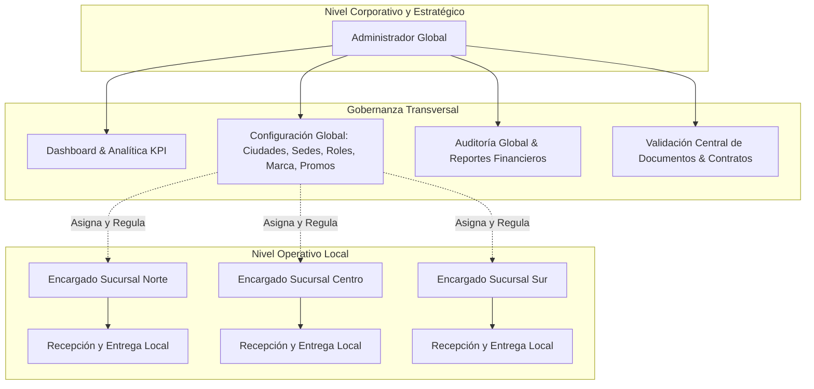

# 🚗 Drivique — Guía Técnica, Funcional y Libreto de Sustentación del Administrador Global

---

## 📌 1. ¿Qué es y Para Qué se Creó el Rol de Administrador Global?

### 1.1 Justificación de Negocio y Arquitectura
En una plataforma de alquiler y gestión de flotas vehiculares a escala comercial como **Drivique**, coexisten dos niveles fundamentales de operación:
1. **El Nivel Táctico / Operativo Local (Encargado de Sucursal):** Centrado en el día a día de una sede física concreta (entregar las llaves del vehículo, recibir el retorno, inspeccionar daños mecánicos en patio y cobrar depósitos locales).
2. **El Nivel Estratégico y de Gobernanza Corporativa (Administrador Global):** Diseñado para tener **visión 360° y control transversal** de toda la compañía, sin estar atado a una sede física particular.

El rol de **Administrador Global (`administrador` / `SUPER_ADMIN`)** se creó para resolver los siguientes retos empresariales:
- **Gobierno Centralizado Multi-Sucursal:** Controlar de manera unificada la flota vehicular distribuida en múltiples ciudades y sedes físicas (Bogotá, Medellín, Cali, Barranquilla, etc.), evitando la dispersión de información y silos operativos.
- **Principio de Mínimo Privilegio y Seguridad:** Garantizar que los encargados de sucursal no puedan manipular parámetros globales (como creación de sucursales, edición de roles, tarifas maestras, configuración de marca corporativa o borrado de registros de auditoría).
- **Gestión de Cumplimiento Legal y Prevención de Fraude:** Supervisar la validación documental (KYC - Cédulas y Licencias de Conducción) y la validez jurídica de los contratos de arrendamiento digitalmente firmados antes de cualquier desembolso o entrega de activos de alto valor.
- **Toma de Decisiones Basada en Datos (Business Intelligence):** Consolidar ingresos globales, tasas de ocupación de flota, tendencias de reserva y métricas de satisfacción del cliente en tiempo real.
- **Escalabilidad y Flexibilidad de Marca (White-Label):** Permitir que la plataforma se expanda a nuevas ciudades o adapte su identidad institucional (logotipo, tipografía, paleta de colores) directamente desde la interfaz, sin requerir reprogramación de código.



---

## 🖥️ 2. Estructura de la Interfaz y Lógica por Sección

El panel del Administrador Global cuenta con una barra de navegación lateral organizada jerárquicamente en 4 grandes bloques funcionales, complementada con soporte nativo de **Modo Oscuro / Claro**, sistema de diseño reactivo y controles de accesibilidad.

```
┌─────────────────────────────────────────────────────────────┐
│                   PANEL ADMINISTRADOR GLOBAL                │
├─────────────────┬───────────────────────────────────────────┤
│ 1. MONITOREO    │ • Dashboard General (KPIs y Gráficas)     │
├─────────────────┼───────────────────────────────────────────┤
│ 2. GESTIÓN      │ • Flota y Vehículos                       │
│    OPERATIVA    │ • Reservas (con KYC y Contrato)           │
│                 │ • Pagos / Cobro Sucursal                  │
│                 │ • Contratos y Firmas Digitales            │
│                 │ • Validación de Documentos (KYC)          │
│                 │ • Domicilio Reserva (Entregas)            │
├─────────────────┼───────────────────────────────────────────┤
│ 3. CONSULTA Y   │ • Reseñas y Calificaciones                │
│    AUDITORÍA    │ • Reportes Gerenciales y Exportación      │
│                 │ • Auditoría y Registro de Actividad       │
├─────────────────┼───────────────────────────────────────────┤
│ 4. CONFIGURACIÓN│ • Usuarios y Clientes                     │
│    GLOBAL       │ • Roles y Permisos (RBAC)                 │
│                 │ • Sucursales Físicas                      │
│                 │ • Ciudades de Cobertura                   │
│                 │ • Promociones y Cupones                   │
│                 │ • Personalización de Marca (White-Label)  │
└─────────────────┴───────────────────────────────────────────┘
```

---

### 2.1 Bloque 1: MONITOREO

#### 📊 Dashboard General (`/admin` — `ManagementDashboard.jsx`)
- **Lógica y Propósito:** Es la torre de control ejecutiva del sistema. Al autenticarse el Administrador Global, este componente orquesta múltiples peticiones concurrentes para calcular las métricas vitales del negocio.
- **Componentes y Funcionalidades:**
  1. **Tarjetas KPI en Tiempo Real:**
     - **Vehículos Totales:** Tamaño total de la flota registrada.
     - **Vehículos Disponibles vs. Alquilados vs. En Mantenimiento:** Tasa de disponibilidad operativa.
     - **Reservas Activas:** Volumen de transacciones en curso o confirmadas.
     - **Ingresos Totales:** Facturación acumulada convertida a la moneda activa (COP/USD) con formato financiero.
  2. **Gráficos de Tendencia y Ocupación:** Visualización interactiva de ingresos mensuales y tasa de utilización de vehículos por categoría (SUV, Sedán, Deportivo, Camioneta).
  3. **Tabla de Reservas Recientes:** Monitoreo en vivo de los últimos movimientos: código de reserva, miniatura del vehículo con función de lupa/zoom modal, cliente, fecha, medio de pago (Wompi, Efectivo en Sucursal) y estado de pago (Recibido / No Recibido).
  4. **Accesos Rápidos Estratégicos:** Enlaces directos a los módulos con mayor flujo operativo.

---

### 2.2 Bloque 2: GESTIÓN OPERATIVA

#### 🚗 Flota y Vehículos (`/admin/vehicles` — `VehicleManagementPage.jsx`)
- **Lógica:** Permite la administración integral del ciclo de vida del inventario vehicular.
- **Acciones Clave:**
  - Registrar nuevos vehículos con especificaciones técnicas (placa, marca, modelo, año, transmisión manual/automática, combustible, capacidad de pasajeros, maletas, kilometraje y precio diario).
  - Carga y previsualización de galería fotográfica de alta resolución.
  - Asignación de vehículos a sucursales físicas específicas para disponibilidad geográfica.
  - Cambio de estado operativo: *Disponible*, *Alquilado*, *En Mantenimiento* o *Inactivo*.

#### 📅 Reservas (`/admin/reservations` — `ReservationManagementPage.jsx`)
- **Lógica:** Es el núcleo transaccional del negocio. Muestra todas las reservas originadas desde la Web, la App Móvil o en mostrador.
- **Capacidades Críticas Implementadas:**
  - **Filtros Avanzados:** Por estado (*Pendiente*, *Confirmada*, *En Curso*, *Finalizada*, *Cancelada*), por rango de fechas y por buscador de texto libre (código, cliente, placa).
  - **Verificación KYC en la Fila:** Columnas dedicadas para visualizar Cédula de Ciudadanía y Licencia de Conducción. Si el documento no cuenta con un archivo binario en disco, el sistema despliega un **Certificado Oficial de Verificación KYC** con sellos institucionales y datos del cliente, evitando errores de renderizado.
  - **Acceso Directo al Contrato Firmado:** Botón interactivo `Sí · Ver Contrato` que despliega el contrato de arrendamiento legal completo con la firma manuscrita digitalizada del cliente.

#### 💵 Pagos y Cobro en Sucursal (`/admin/cobro-sucursal` — `CashCollectionPage.jsx`)
- **Lógica:** Control de flujo de caja para reservas liquidadas en efectivo o tarjetas en el punto de atención.
- **Acciones Clave:**
  - Registro de recepción de pagos contra entrega o anticipados.
  - Conciliación de montos entre el sistema central y los arqueos de caja física reportados por cada sucursal.
  - Historial de comprobantes de pago emitidos.

#### 📝 Contratos de Arrendamiento (`/admin/contracts` — `ContractManagementPage.jsx`)
- **Lógica:** Centralización de los acuerdos jurídicos generados entre Drivique y los usuarios.
- **Capacidades Críticas Implementadas:**
  - Consulta del número legal de contrato generado automáticamente (ej. `CTR-2026-XXXX`).
  - Modal de lectura en solo lectura con cláusulas de responsabilidad civil, cobertura de seguro y condiciones de uso.
  - **Visor de Firma Digital (`ContractSignature.jsx`):** Renderizado de la firma digital trazada por el cliente desde el dispositivo móvil o pantalla táctil. Cuenta con un generador dinámico de firma caligráfica SVG vectorial basada en el nombre del cliente cuando se visualizan contratos de prueba o sin captura previa en disco.
  - Exportación y descarga del contrato legal en formato PDF.

#### 🆔 Validación de Documentos KYC (`/admin/documents` — `DocumentVerificationPage.jsx`)
- **Lógica:** Módulo de cumplimiento normativo y seguridad anti-suplantación.
- **Acciones Clave:**
  - Bandeja de entrada de documentos cargados por nuevos usuarios (Documento de Identidad frontal/reverso y Licencia de Conducción vigente).
  - Visor modal seguro con soporte para imágenes, PDFs y fichas técnicas certificadas.
  - Dictamen administrativo: botón de **Aprobar** o **Rechazar con Observaciones** (ej. "Licencia vencida o ilegible"), notificando automáticamente al usuario.

#### 🚚 Domicilio de Reserva / Entregas (`/admin/deliveries` — `DeliveryManagementPage.jsx`)
- **Lógica:** Gestión logística del servicio de entrega y recogida de vehículos a domicilio (aeropuertos, hoteles o domicilios particulares).
- **Acciones Clave:**
  - Asignación de conductor/operador logístico responsable del traslado.
  - Seguimiento del estado del despacho: *Programado*, *En Ruta*, *Entregado al Cliente*, *Recogido*.
  - Validación de dirección y georreferenciación de entrega.

---

### 2.3 Bloque 3: CONSULTA Y AUDITORÍA

#### ⭐ Reseñas y Calificaciones (`/admin/reviews` — `BranchReviewsPage.jsx`)
- **Lógica:** Medición de calidad y satisfacción del cliente (CSAT / NPS).
- **Acciones Clave:**
  - Monitoreo de comentarios y puntuaciones (1 a 5 estrellas) otorgadas a cada vehículo y experiencia de sucursal.
  - Detección de patrones de insatisfacción o problemas recurrentes en vehículos específicos.

#### 📈 Reportes Gerenciales (`/admin/reports` — `ReportsManagementPage.jsx`)
- **Lógica:** Motor de analítica cuantitativa y financiera para gerencia general.
- **Acciones Clave:**
  - Generación de balances consolidados: Ingresos por sucursal, vehículos con mayor rentabilidad, clientes más recurrentes, tasas de cancelación.
  - Filtros paramétricos por fechas y categorías.
  - Exportación de conjuntos de datos limpios a **Excel (.xlsx), CSV y PDF** para auditoría contable externa.

#### 🛡️ Auditoría y Registro de Actividad (`/admin/audit` — `AuditLogManagementPage.jsx`)
- **Lógica:** Trazabilidad forense e inmutable de seguridad del sistema.
- **Acciones Clave:**
  - Registro cronológico detallado de eventos críticos: inicios de sesión, cambios de contraseña, creación/edición de vehículos, cancelaciones de reservas, aprobaciones de documentos KYC.
  - Identificación del actor (usuario, rol), dirección IP, fecha/hora exacta y descripción técnica del cambio efectuado.

---

### 2.4 Bloque 4: CONFIGURACIÓN GLOBAL (Exclusivo Administrador Global)

#### 👥 Gestión de Usuarios (`/admin/users` — `UserManagementPage.jsx`)
- **Lógica:** Directorio maestro de todos los usuarios registrados en el ecosistema (clientes, personal administrativo, encargados).
- **Acciones Clave:** Búsqueda por documento/correo, activación, suspensión preventiva de cuentas fraudulentas y consulta de historial de alquileres.

#### 🔐 Roles y Permisos RBAC (`/admin/roles` — `AdminRolesManagementPage.jsx`)
- **Lógica:** Motor de seguridad RBAC (*Role-Based Access Control*).
- **Acciones Clave:**
  - Asignación de credenciales y privilegios (`CLIENTE`, `ENCARGADO_SUCURSAL`, `ADMINISTRADOR`).
  - Configuración granular de capacidades sobre los módulos del sistema.

#### 🏢 Sucursales Físicas (`/admin/branches` — `BranchManagementPage.jsx`)
- **Lógica:** Gestión de la red de sedes comerciales de Drivique a nivel nacional.
- **Acciones Clave:**
  - Crear nuevas sucursales definiendo: nombre, ciudad perteneciente, dirección exacta, número telefónico, horario de atención y capacidad de parqueo.
  - Asignar el Encargado de Sucursal responsable de cada sede.

#### 📍 Ciudades de Cobertura (`/admin/cities` — `CityManagementPage.jsx`)
- **Lógica:** Catálogo geopolítico que delimita las zonas urbanas autorizadas para operación, entrega a domicilio y apertura de sedes.

#### 🏷️ Promociones y Cupones (`/admin/promotions` — `PromotionManagementPage.jsx`)
- **Lógica:** Motor de mercadeo y fidelización.
- **Acciones Clave:**
  - Creación de códigos promocionales (ej. `DRIVIQUE2026`).
  - Configuración de reglas: porcentaje de descuento, monto fijo, fecha de inicio y caducidad, límite de usos por usuario y monto mínimo de reserva.

#### 🎨 Marca y White-Label (`/admin/brand` — `BrandManagementPage.jsx`)
- **Lógica:** Motor de personalización institucional dinámica.
- **Acciones Clave:**
  - Carga del logotipo oficial corporativo y favicon.
  - Selección de paleta de colores corporativos (Primario, Secundario, Acento) que se inyectan en caliente a las variables CSS del sistema (`--brand-primary`), alterando de inmediato la identidad visual de la web y app sin recompilar.

---

## 🎤 3. Libreto y Guion de Sustentación para la Exposición

> **Objetivo:** Demostrar ante el docente / jurado evaluador el dominio técnico de la arquitectura, la justificación de negocio del rol y la solidez funcional de cada pantalla.

---

### 🕒 Paso 1: Introducción y Justificación del Rol (Tiempo estimado: 1:30 min)
> *"Buenos días / tardes, señores del jurado y profesor. Hoy les presentamos la arquitectura de gestión de **Drivique**, nuestra solución integral de alquiler inteligente de vehículos.*
>
> *Para que una plataforma de este tipo sea viable en el mundo real, no basta con tener una app bonita para el cliente; se requiere una estructura administrativa de dos niveles: un nivel operativo para las sedes físicas, y un nivel corporativo que garantice el control centralizado. Ese nivel corporativo es el que encarna nuestro **Administrador Global**.*
>
> *¿Por qué se creó este rol? Porque en un negocio de alquiler distribuido con sedes en múltiples ciudades, se necesita gobernar la flota completa, garantizar el cumplimiento legal y la seguridad KYC, auditar cada transacción para prevenir fraudes, y tomar decisiones financieras con datos consolidados en tiempo real. Todo esto bajo el principio de menor privilegio: el encargado de sucursal solo ve su propia sede, pero el Administrador Global tiene el control transversal de la organización."*

---

### 🕒 Paso 2: El Dashboard Central y la Toma de Decisiones (Tiempo estimado: 1:30 min)
> *(En pantalla: ingresar a `/admin`)*
>
> *"Comenzamos en la pantalla de bienvenida del Administrador Global: el **Dashboard de Monitoreo**. Como pueden observar, esta interfaz fue concebida como una torre de control ejecutiva:*
>
> 1. *En la parte superior tenemos nuestras tarjetas **KPI en tiempo real**: tamaño de flota activa, disponibilidad de vehículos, reservas en curso y la facturación total consolidada, compatible con multi-moneda (COP y USD).*
> 2. *Contamos con **gráficos interactivos** que analizan la ocupación de flota por tipo de vehículo y la curva de ingresos mensuales.*
> 3. *En la parte inferior vemos la **tabla de reservas en vivo**: cada fila nos muestra el vehículo con su respectiva placa, el cliente, la fecha, el método de pago (ya sea Wompi digital o pago en sucursal) y la miniatura del vehículo con zoom modal interactivo.*
> 4. *Es importante destacar que el sistema cuenta con soporte de **Modo Oscuro y Claro**, adaptándose a las preferencias visuales del usuario corporativo con contrastes y paletas HSL profesionales."*

---

### 🕒 Paso 3: Gestión Operativa, Seguridad KYC y Contratos Digitales (Tiempo estimado: 2:00 min)
> *(En pantalla: navegar a `/admin/reservations` y luego a `/admin/contracts`)*
>
> *"Pasando al bloque de **Gestión Operativa**, resolvemos uno de los mayores desafíos del sector: **la seguridad y la legalidad**.*
>
> *En la pantalla de **Gestión de Reservas**, el Administrador puede auditar todas las reservas del sistema. Si observan las columnas de verificación documental, el sistema integra la validación KYC: podemos inspeccionar directamente la Cédula de Ciudadanía y la Licencia de Conducción del cliente.*
>
> *Si hacemos clic en el botón **'Sí · Ver Contrato'**, se nos abre el modal de lectura del **Contrato de Arrendamiento Vehicular**. Este contrato contiene las cláusulas legales vigentes, los datos de la reserva y, en la sección inferior, la **Firma Digital Manuscrita** registrada por el cliente. Si por motivos de prueba o almacenamiento no existiese una firma previa, nuestro componente genera dinámicamente un trazo caligráfico vectorial seguro en SVG, asegurando que ningún contrato carezca de respaldo jurídico visual.*
>
> *Además, en la sección de **Validación de Documentos (KYC)**, el administrador puede aprobar o rechazar licencias de conducir con un solo clic, garantizando que nadie pueda retirar un vehículo si sus documentos no están vigentes y validados."*

---

### 🕒 Paso 4: Configuración Global, Marca y Auditoría Inmutable (Tiempo estimado: 2:00 min)
> *(En pantalla: navegar a `/admin/branches`, `/admin/brand` y `/admin/audit`)*
>
> *"Lo que hace verdaderamente potente y escalable a Drivique son sus módulos de **Configuración Global**, exclusivos de este rol:*
>
> 1. ***Sucursales y Ciudades:** Aquí la empresa puede expandirse. Creamos nuevas sedes físicas en cualquier ciudad del país, definimos sus horarios de atención, coordenadas y asignamos a su respectivo Encargado de Sucursal.*
> 2. ***Personalización de Marca (White-Label):** Desde esta pantalla, sin tocar una sola línea de código, el administrador puede cambiar el logotipo, nombre comercial y la paleta de colores institucional. El sistema inyecta estas propiedades como variables CSS en tiempo de ejecución, actualizando instantáneamente la apariencia de la plataforma.*
> 3. ***Auditoría y Trazabilidad:** En el módulo de Auditoría queda registrado de manera inmutable cada evento crítico: qué usuario ingresó, qué cambio de estado se realizó, a qué hora y desde qué dirección IP. Esto garantiza máxima transparencia operativa y seguridad frente a cualquier eventualidad."*

---

### 🕒 Paso 5: Conclusión y Cierre de la Sustentación (Tiempo estimado: 1:00 min)
> *"En conclusión, el rol de **Administrador Global** en Drivique no es un simple panel de control, sino el motor de gobernanza que transforma una aplicación de software en una **plataforma empresarial robusta, escalable, jurídicamente segura y lista para operar en el mercado real**.*
>
> *El código se encuentra modularizado con React y Vite en el frontend, validaciones estrictas por roles mediante RBAC y persistencia desacoplada en el backend.*
>
> *Quedamos a su entera disposición para cualquier pregunta técnica o demostración en vivo de los módulos. Muchas gracias."*

---

## 📋 Resumen Rápido de Rutas del Administrador Global

| Sección | Clave Módulo | Ruta URL | Componente Principal |
| :--- | :--- | :--- | :--- |
| **Monitoreo** | `dashboard` | `/admin` | `ManagementDashboard.jsx` |
| **Gestión Operativa** | `vehicles` | `/admin/vehicles` | `VehicleManagementPage.jsx` |
| **Gestión Operativa** | `reservations` | `/admin/reservations` | `ReservationManagementPage.jsx` |
| **Gestión Operativa** | `cashCollection` | `/admin/cobro-sucursal` | `CashCollectionPage.jsx` |
| **Gestión Operativa** | `contracts` | `/admin/contracts` | `ContractManagementPage.jsx` |
| **Gestión Operativa** | `documents` | `/admin/documents` | `DocumentVerificationPage.jsx` |
| **Gestión Operativa** | `deliveries` | `/admin/deliveries` | `DeliveryManagementPage.jsx` |
| **Consulta y Auditoría** | `reviews` | `/admin/reviews` | `BranchReviewsPage.jsx` |
| **Consulta y Auditoría** | `reports` | `/admin/reports` | `ReportsManagementPage.jsx` |
| **Consulta y Auditoría** | `audit` | `/admin/audit` | `AuditLogManagementPage.jsx` |
| **Configuración Global** | `users` | `/admin/users` | `UserManagementPage.jsx` |
| **Configuración Global** | `roles` | `/admin/roles` | `AdminRolesManagementPage.jsx` |
| **Configuración Global** | `branches` | `/admin/branches` | `BranchManagementPage.jsx` |
| **Configuración Global** | `cities` | `/admin/cities` | `CityManagementPage.jsx` |
| **Configuración Global** | `promotions` | `/admin/promotions` | `PromotionManagementPage.jsx` |
| **Configuración Global** | `brand` | `/admin/brand` | `BrandManagementPage.jsx` |
| **Notificaciones** | `notifications` | `/admin/notifications` | `BranchNotificationCenterPage.jsx` |

---
*Documento generado para el proyecto Drivique — Sistema de Gestión y Alquiler de Vehículos.*
